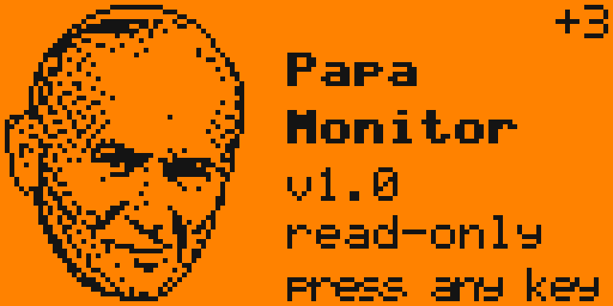

# Flipper Power Monitor

Native Flipper Zero application (`.fap`) that monitors the battery, charging and
USB input using only the built-in **BQ25896** charger and **BQ27220** fuel gauge.
No external sensors, wires or GPIO modules.

The application is **read-only**: it never writes to the charger or the gauge and
does not change any charging or power setting.

- Target: official Flipper Zero firmware (built and checked against release **1.5.1**, API 88.2)
- Also builds for **Momentum** firmware (checked against `mntm-012`, API 87.1) - see [Firmware compatibility](#firmware-compatibility)
- Category: `Tools` - installed as `/ext/apps/Tools/power_monitor.fap`



*Splash screen preview, 6x scale. The portrait is pixel exact; text is drawn with
an approximate font, on the device it uses the Flipper system font.*

## What it measures

| Value | Source | API | Resolution / notes |
|---|---|---|---|
| USB input voltage (VBUS) | BQ25896 ADC | `furi_hal_power_get_usb_voltage()` | 100 mV; 0 when no valid input |
| Battery voltage | BQ27220 | `furi_hal_power_get_battery_voltage(FuelGauge)` | 1 mV |
| Battery current (signed) | BQ27220 | `furi_hal_power_get_battery_current(FuelGauge)` | 1 mA, + charging / - discharging, gauge updates about once per second |
| Charge current | BQ25896 ADC | `furi_hal_power_get_battery_current(Charger)` | 50 mA steps, only while charging |
| Battery power | computed | `P = U * I` | Battery power, **not** USB input power |
| State of charge | BQ27220 | `furi_hal_power_get_pct()` | % |
| Battery temperature | BQ27220 | `furi_hal_power_get_battery_temperature(FuelGauge)` | 0.1 C |
| Charging / charge done / OTG | BQ25896 | `furi_hal_power_is_charging()`, `..._is_charging_done()`, `..._is_otg_enabled()` | |
| Remaining / full / design capacity | BQ27220 | `furi_hal_power_get_battery_*_capacity()` | mAh |
| State of health | BQ27220 | `furi_hal_power_get_bat_health_pct()` | % as reported by the gauge |
| Charge voltage limit | BQ25896 | `furi_hal_power_get_battery_charge_voltage_limit()` | read only |
| Cycle count, time to empty / full, gauge status flags | BQ27220 | read-only I2C (`Ext. regs`) | see below |
| Charge phase (pre / fast / done), input type, power good | BQ25896 `REG0B` | read-only I2C (`Ext. regs`) | |
| Input current limit in effect, VINDPM / IINDPM | BQ25896 `REG13` | read-only I2C (`Ext. regs`) | a limit, not a measurement |

### Extended register reads (`Ext. regs`)

`furi_hal_power` does not expose cycle count, time to empty/full, the gauge
`BatteryStatus` flags or the charger status registers. The SDK does export the
I2C HAL (`furi_hal_i2c_acquire/trx/read_reg_8/release` and
`furi_hal_i2c_handle_power`), so the app reads these registers the same way the
firmware drivers do: bus acquired, a register **read**, bus released. No writes.
The feature can be switched off in Settings; the app then uses only
`furi_hal_power` and shows `n/a` or a clearly marked estimate (`~`).

The charger fault register `REG0C` is **never read on purpose**: its bits are
latched and cleared on read, and the firmware Power service reads it every second
to detect OTG faults. Reading it from an app could hide a fault from the firmware.

### What cannot be measured

- **Total USB input current / power / energy.** The BQ25896 has no input current
  ADC (no IBUS measurement), so nothing on the board measures how much current
  comes from USB. While charging, USB power = battery charge power + system load
  + converter losses, and only the first term is measured. The app therefore
  shows battery power and battery energy only, and says "USB input: not
  measurable" instead of inventing a number.
- **Charger fault reasons** (input fault, thermal shutdown, safety timer) - they
  live in `REG0C`, see above. Gauge-side alarms (over-temperature, charge inhibit,
  terminate charge/discharge alarm) are shown instead.
- **Cycle count / time to empty / time to full** with `Ext. regs` off.

The app's own activity is part of what it measures: the CPU, the display and
especially the **backlight** draw current from the battery.

## Screens and buttons

| Button | Action |
|---|---|
| Left / Right | Previous / next screen |
| Up / Down | Graphs: switch V / I / P. Lists: scroll. Settings: select |
| OK | Screen action (see below) |
| Back | Return to Dashboard; on Dashboard: exit |
| Long Back | Exit from any screen |

| # | Screen | Content | OK |
|---|---|---|---|
| - | Splash | Portrait, "Papa Monitor", version, closes after 2.5 s or any key | - |
| 1 | Dashboard | USB V, battery V, current, power, %, temperature, charge phase | Start / stop CSV |
| 2 | Graphs | Last 60 s of battery V, I or P, auto-scaled, zero line | Pause / resume |
| 3 | Statistics | MIN / AVG / MAX of V, I, P, session time | Reset |
| 4 | Battery energy | Energy into / out of battery (mWh / Wh), net, mAh, measured time | Reset counters |
| 5 | Charging | Phase, USB, input type, currents, peak, trend, charging time, flags, event log | Clear events |
| 6 | Battery health | Capacities, SOH, full/design ratio, cycles, time to empty / full | Refresh |
| 7 | Settings | Sampling interval, CSV interval, CSV on/off, `Ext. regs`, backlight | Change value |

Settings are saved to `/ext/apps_data/power_monitor/settings.bin`.

Measurement details:

- Sampling every **250 / 500 / 1000 ms** (default 500 ms). Fast values are read
  every sample, capacities and gauge flags once per second.
- Energy and charge are integrated with the trapezoidal rule over the **real time
  between samples**, so changing the interval during a session is handled. A
  segment where power changes sign is split at the zero crossing, so the charge
  and discharge counters stay separate. Gaps longer than 10 s are not integrated
  (counted as "Data gaps").
- AVG in Statistics is time-weighted for the same reason.
- Charge current trend compares the average of the last 10 s with the 10 s before
  (threshold 25 mA).

## CSV files

`OK` on the Dashboard (or `CSV logging` in Settings) starts a new session file:

```
/ext/apps_data/power_monitor/pm_YYYYMMDD_HHMMSS.csv
```

```
date,time,uptime_ms,usb_v,bat_v,bat_current_ma,charge_current_ma,bat_power_w,temp_c,soc_pct,charge_state,usb_present,e_charge_mwh,e_discharge_mwh
2026-11-04,18:05:09,123456,5.1,4.123,-420,0,-1.732,24.5,78,not_charging,1,1.500,12.250
```

- Interval: 1 / 5 / 10 / 30 / 60 s (default 5 s). Date and time come from the RTC.
- `bat_current_ma` and `bat_power_w` are battery values (+ = charging).
- `charge_state`: `not_charging`, `precharge`, `fast`, `charging` (phase unknown), `done`.
- Data is synced to the card every 10 rows and the file is closed on stop, on exit
  and on a write error. No card: "No SD card" and logging does not start.
  Card removed while logging: "SD write error", logging stops, the app keeps running.

## Build with uFBT on macOS

Requirements: macOS with Python 3.8 or newer, a USB-C data cable. uFBT downloads
the official SDK and the ARM toolchain by itself.

```bash
# 1. Install uFBT (pipx keeps it isolated)
brew install pipx
pipx install ufbt

# 2. Download the SDK of the current official release
ufbt update --channel=release

# 3. Build (run in the project directory)
cd flipper-power-monitor
ufbt
# -> dist/power_monitor.fap
```

Without Homebrew/pipx: `python3 -m venv ~/.ufbt-venv && ~/.ufbt-venv/bin/pip install ufbt`
and use `~/.ufbt-venv/bin/ufbt`.

The SDK version must match the firmware on your Flipper. Keep both on the current
official release (update the Flipper with qFlipper, then run
`ufbt update --channel=release`). Other ways to select an SDK are listed in
`ufbt update --help`.

### Firmware compatibility

A `.fap` carries the API version of the SDK it was built with. If it does not
match the firmware, the Flipper shows e.g. `APP:88 > FW:87 This app might not
work`. Do not continue: rebuild for your firmware instead.

| Firmware | SDK command | API |
|---|---|---|
| Official release | `ufbt update --channel=release` | 88.2 (1.5.1) |
| Momentum release | `ufbt update --index-url=https://up.momentum-fw.dev/firmware/directory.json --channel=release` | 87.1 (mntm-012) |

Then run `ufbt` again. Both builds were checked with uFBT `APPCHK`: every symbol
the app imports is present in the firmware API table. For Momentum, update the
Flipper to the same Momentum release the SDK was taken from.

## Install on Flipper Zero

**Option A - uFBT (build, upload, start):**

1. Connect the Flipper over USB, unlock it, close qFlipper (it holds the serial port).
2. Run `ufbt launch` in the project directory.

**Option B - qFlipper or SD card:**

1. Copy `dist/power_monitor.fap` to `SD Card/apps/Tools/`.
2. On the Flipper: `Apps > Tools > Power Monitor`.

## Testing

### Host unit tests (no Flipper needed)

```bash
make -C tests
```

Covers energy integration (constant load, variable interval, zero crossing, gaps,
tick wrap-around), statistics, graph history and autoscaling, register decoding,
charging events and trend, health and time estimates, CSV format and settings.
Built with `-Werror`, AddressSanitizer and UndefinedBehaviorSanitizer.

### Measurement test procedure on the device

Write down the firmware version and keep the Flipper at room temperature.

1. **Cross-check with the firmware.** Open `Settings > Power > Battery Info` and
   note charge %, voltage, current and health. Start Power Monitor: Dashboard
   `BAT`, `CURRENT`, `BATTERY` and Battery Health `SOH` must match within one
   update (current changes by a few mA between readings).
2. **Discharge sign and response.** Unplug USB. `USB` shows `-- V`, the phase is
   `DIS`, `CURRENT` and `POWER` are negative. Go to `Graphs`, select current
   (Up/Down), then in `Settings` switch `Backlight` to `ON` and back: the graph
   must show a clear step in discharge current.
3. **Charging.** Plug in a USB charger. Within about 1 s: `USB` about 5.0 V, phase
   `PRE`/`FAST`/`CHG`, `CURRENT` positive. On `Charging`: `I charger ADC` is close
   to `I battery` (charger ADC has 50 mA steps and does not see the system load),
   events `USB connected` and `Charge start` appear, `Charging for` counts up.
4. **USB tester (optional).** With an inline USB-C power meter, VBUS must agree
   within about 0.1 V. The meter's current is the total input current and must be
   higher than the battery charge current; the difference is the system load and
   losses, which the Flipper itself cannot measure.
5. **Energy counter vs. gauge.** Reset `Battery energy` (OK), note `Remaining` on
   `Battery health`, then let the Flipper run unplugged for 15-30 min. The `Charge`
   line (`-... mAh`) must agree with the drop of `Remaining` within a few mAh.
6. **End of charge.** Charge to 100 %: phase `FULL`, event `Charge done`,
   `Last charge` shows the charging time, `FC` appears in `Flags`.
7. **CSV.** Start logging on the Dashboard (`REC` appears), wait a few intervals,
   stop it ("Saved N rows"). Open the file from the SD card in qFlipper and check
   the columns. Start logging without an SD card: "No SD card". Exit the app with
   long Back while logging and check that the file is complete.
8. **OTG.** Enable 5 V output (`GPIO > 5V on GPIO`): Dashboard shows `OTG out`,
   the event log shows `OTG on`.
9. **Ext. regs off.** Switch `Ext. regs` to `OFF`: `Cycles` shows `n/a (ext off)`,
   times to empty/full become `~` estimates, the phase shows `CHG` instead of
   `PRE`/`FAST`. All other values keep working.

## Project structure

| File | Purpose |
|---|---|
| `application.fam` | App manifest (tests excluded from the build) |
| `power_monitor.c`, `power_monitor_i.h` | Entry point, main loop, input, app state |
| `pm_hw.*` | Hardware reading (furi_hal_power + read-only I2C) |
| `pm_energy.*` | Power and energy integration |
| `pm_stats.*` | MIN / MAX / AVG |
| `pm_history.*` | Graph history and autoscaling |
| `pm_charge.*` | Charging diagnostics, register decoding, events |
| `pm_health.*` | Battery health analysis |
| `pm_csv.*`, `pm_logger.*` | CSV formatting and SD card files |
| `pm_settings.*`, `pm_settings_store.*` | Settings and persistence |
| `pm_ui.*`, `pm_format.*`, `pm_pope.*` | Screens, text formatting, splash art |
| `tests/` | Host unit tests |

## License

This project is licensed under the PolyForm Noncommercial License 1.0.0.

Free use, modification, and distribution are permitted under the terms of the license for noncommercial purposes.

Commercial use requires a separate license or prior written permission from the copyright holder.

See the [LICENSE](LICENSE) file for details.
